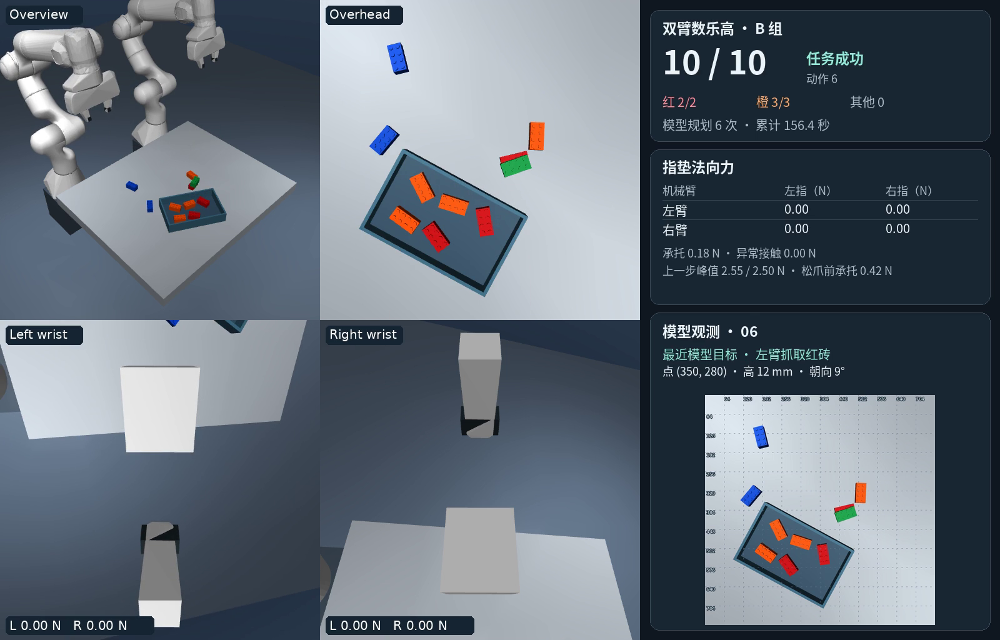

# 双臂数乐高 · MuJoCo

双 Panda 机械臂根据俯视图选择积木、清除遮挡，并在力反馈下完成抓放。目标是把恰好 2 块红砖和 3 块橙砖装进箱子。



## 作品与数据

- [portfolio.html](portfolio.html) 是单文件交互作品。下载后在浏览器打开即可播放录像并逐步查看抓取点、朝向、离桌高度与力反馈。
- [portfolio.zip](portfolio.zip) 包含离线作品页、封面和作品简介。[replay.mp4](replay.mp4) 是 80.65 秒四路同步回放。录像压缩了决策等待，保留实际累计耗时。
- [score.json](score.json) 和 [observations.zip](observations.zip) 保存这一轮的六次动作、模型输入图、力反馈及计分记录。种子为 `605241657`，箱内最终为 2 红、3 橙，本轮得分 **10/10**。
- [comparison.json](comparison.json) 记录四个配对种子的 A/B 结果。A 组使用仿真位姿校正，B 组采用图像估计。两组各完成 4/4，这组结果适用于本次仿真场景。

## 复现已记录的实验

在 Linux 上准备 Python 3.12、MuJoCo EGL、FFmpeg、DejaVu Sans 与 Noto Sans CJK 字体。以下命令使用仓库根目录作为工作目录。

```bash
python3 -m venv .venv
source .venv/bin/activate
pip install -r requirements.txt
python -m zipfile -e scene-assets.zip .
MUJOCO_GL=egl python replay_from_score.py score.json runs/replay
```

重放会复用已记录的动作和模型耗时，生成 `runs/replay/episode.mp4` 和评分。用于实验的 Panda 网格来自 Bullet 的 `pybullet_data/franka_panda`，资产压缩包包含上游许可和转换后的 MJCF。围绕模型生成的场景、运动和记录逻辑在 `experiment.py` 与 `lego_recording.py`。

## 实时网页与 A/B

将同一仓库放在配有上述依赖和资产的 Linux 仿真主机上。本地需要安装 Paramiko 以及已登录、可使用实验模型的 Codex CLI。通过本地运行环境配置 `ROBOT_SIM_HOST`、`ROBOT_SIM_USER` 和 `ROBOT_SIM_REMOTE_DIR`，其中远程目录指向远端仓库根目录。

`ROBOT_SIM_PYTHON` 可指定远端虚拟环境中的 Python 路径，默认使用 `python3`。如使用非默认 SSH 端口，设置 `ROBOT_SIM_PORT`。主机公钥由运行者确认后纳入本机 `known_hosts`，非默认文件可通过 `ROBOT_SIM_KNOWN_HOSTS` 指定。可使用 SSH 密钥，或从本地环境读取 `ROBOT_SIM_SSH_PASSWORD`。

```bash
python live_viewer.py
```

打开 `http://127.0.0.1:53856/legos`，选择「再跑一轮」启动 B 组。本地查看器绑定环回地址。

```bash
python run_pose_comparison.py pose_ab_run 52 1498465241 3550491209 4162747307
```

A/B 每对共享初始画面和第一次决策，随后独立闭环，结果写入 `results/pose_ab_run/comparison.json`。
